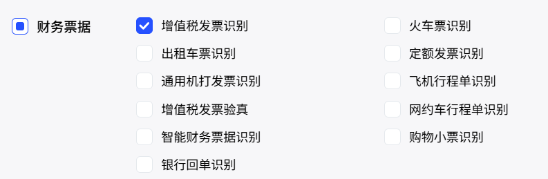
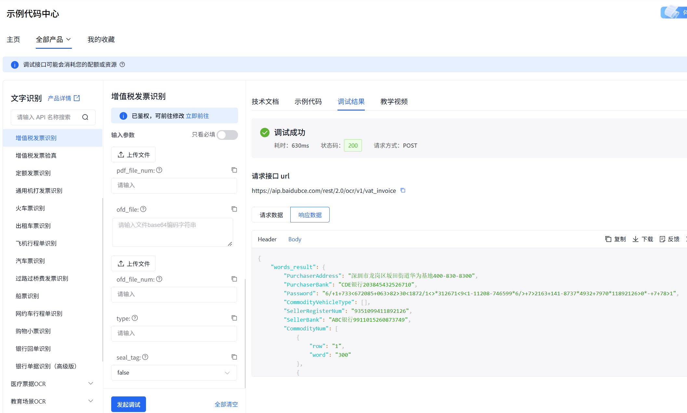
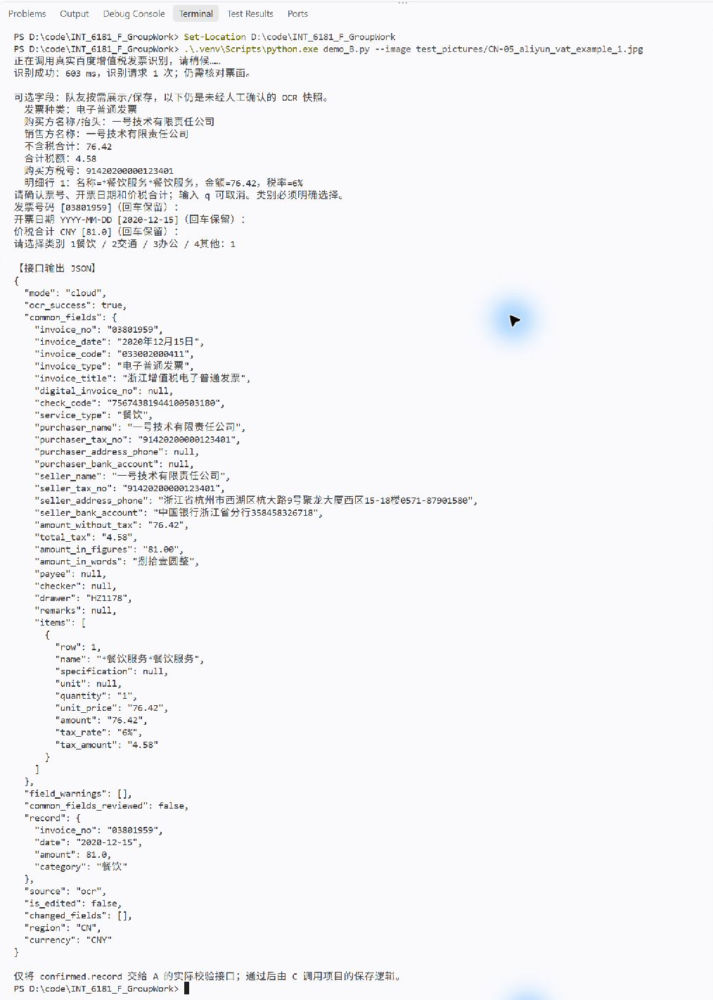
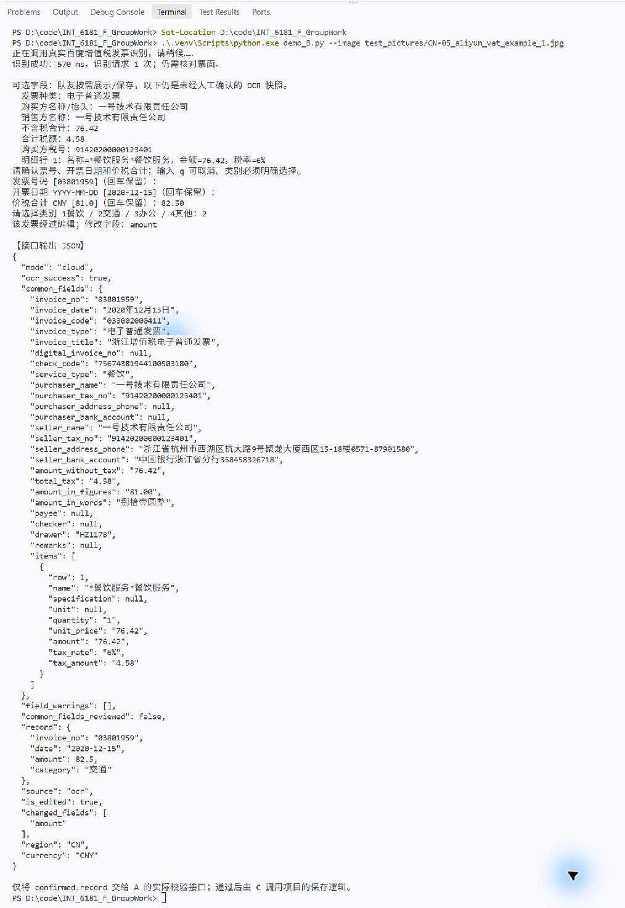
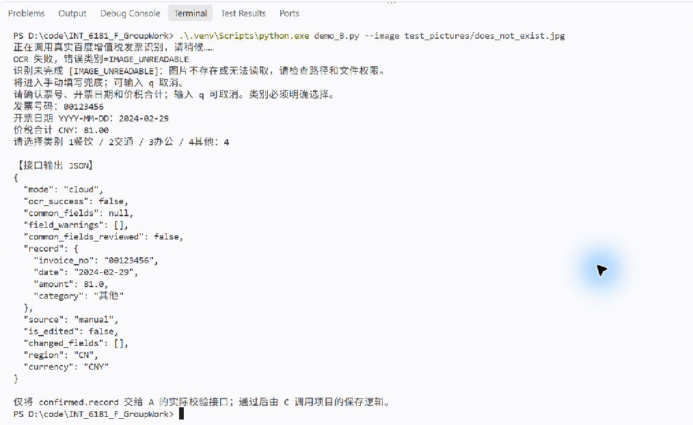
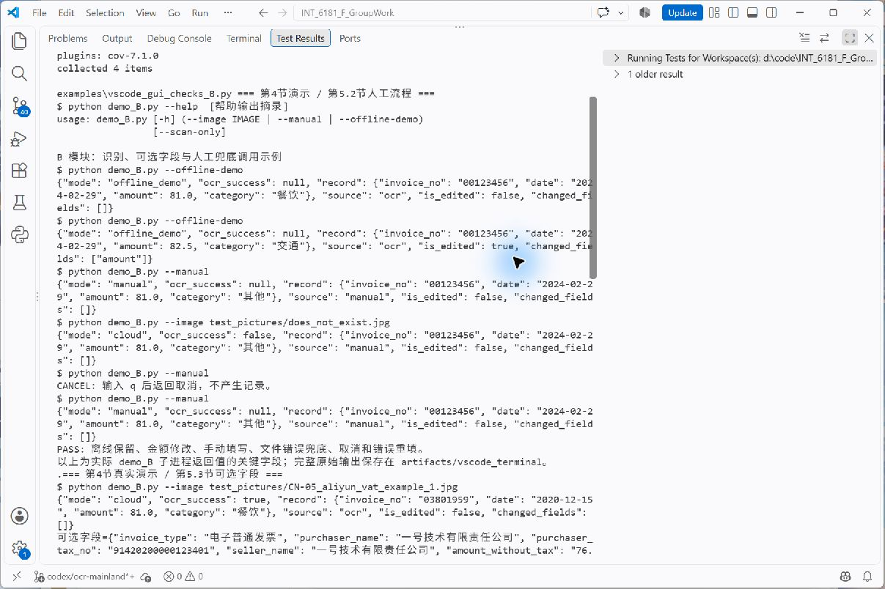
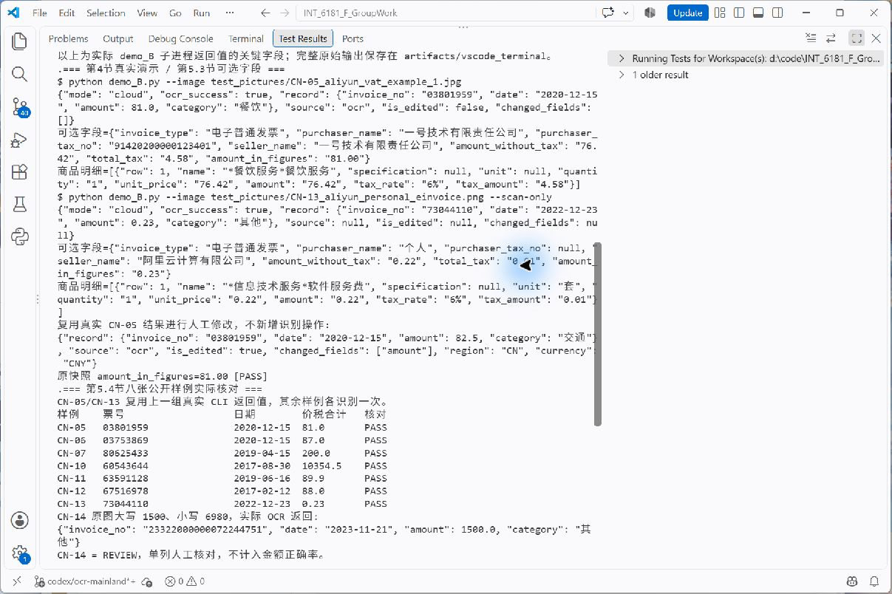
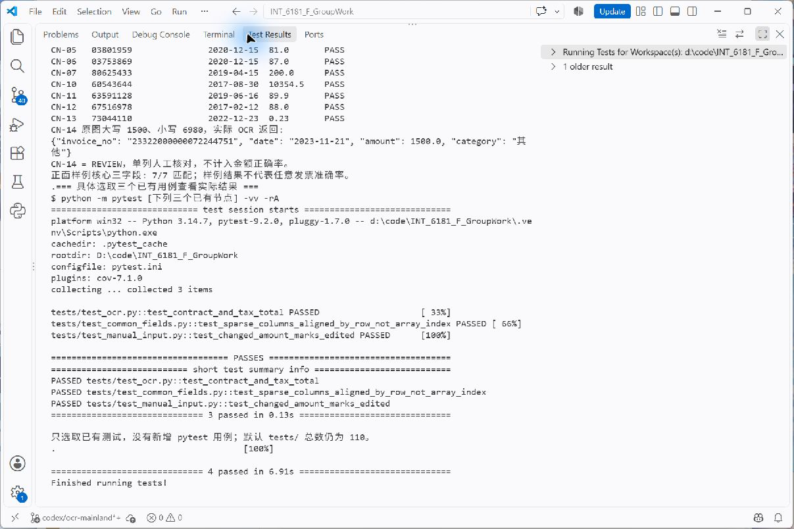

# B 模块 OCR 扫描与手动填写

识别中国大陆增值税发票，提供标准四字段记录、可选票面信息，以及人工确认和手动填写兜底。模块供 Python 程序导入使用；demo_B.py 提供命令行演示，项目主程序 `main.py` 提供与 A 模块联动的桌面界面和手动兜底。A/B 联动运行方式见根目录 [README.md](README.md)。

[文件用途与阅读顺序](#1-模块文件) · [安装与密钥配置](#2-安装与密钥配置) · [接口接入](#3-接口接入) · [演示](#4-演示) · [测试与识别样例](#5-测试与识别样例) · [图片来源](#6-图片来源)

## 1. 模块文件

```text
ocr.py                 # 必交：图片预检、百度识别及字段解析
local_ocr.py           # 可选：本地 RapidOCR 识别及发票核心字段提取
manual_input.py        # 必交：人工确认、修改、手动填写和取消
example_B.py           # 接口调用参考：最简识别、完整录入、纯手动填写
demo_B.py              # 命令行功能演示及完整 JSON 输出
README_B.md            # 安装配置、接口、演示、测试和图片来源
.env.example           # 不含密钥的配置模板
.gitignore             # 忽略本地环境、配置及运行产物
.env                   # 团队共享的真实百度配置，包含敏感凭据
test_pictures/         # 全部交付图片
├── CN-*.jpg / *.png   # 根目录：8 张发票样例，供识别测试
└── screenshots/       # 子目录：9 张服务配置、演示和测试说明截图
```

两个核心模块应位于同一目录。所有命令在仓库根目录执行，python 指向已安装依赖的项目解释器；使用 VS Code 时选择相应解释器即可。

### 1.1 小组成员建议阅读顺序

1. **先看本文第 2、3 节**：安装依赖、取得授权配置，了解接口输入、返回值及取消行为。
2. **再看 [example_B.py](example_B.py)**：通过三个带注释的独立示例，了解怎样调用两个核心模块、读取确认后的记录和可选字段。
3. **需要查看实现时，阅读 [ocr.py](ocr.py) 和 [manual_input.py](manual_input.py)**：优先看 `recognize`、`recognize_detailed`、`collect_invoice` 的说明；正式接入直接导入这些接口。
4. **需要运行和演示时，使用 [demo_B.py](demo_B.py)**：按第 4 节操作，对照终端截图；测试范围与结果见第 5 节。

接入业务程序时，先判断人工结果是否为 `None`，再取 `confirmed.record` 交给后续校验流程；来源、编辑信息及可选快照分别使用。示例和演示文件用于参考，无需成为业务程序的运行依赖。

### 1.2 上传文件的作用

| 文件或目录 | 作用 | 成员使用方式 |
| --- | --- | --- |
| [ocr.py](ocr.py) | 检查图片、调用百度、规范化核心字段，提供可选票面信息和失败原因 | 导入 `recognize()` 或 `recognize_detailed()`，每张图片选择一个入口 |
| [local_ocr.py](local_ocr.py) | 使用 RapidOCR 在本地识别图片文字；图片按版面提取发票种类、销售方、不含税合计、合计税额及商品明细，可检索 PDF 从第一页文本层补充买卖方及金额字段 | 桌面主程序通过“本地 RapidOCR 识别”按钮调用；识别失败可切换百度或手动录入 |
| [manual_input.py](manual_input.py) | 确认或修改识别值；识别失败后从空白填写；支持取消和编辑标记 | 导入 `collect_invoice()`，传入识别记录或 `None` |
| [example_B.py](example_B.py) | 展示三个独立接口调用示例及 Python 返回对象用法 | 优先阅读注释，参考并复制所需调用语句；也可直接运行 |
| [demo_B.py](demo_B.py) | 演示真实识别、离线流程、纯手动填写、只识别及 JSON 输出 | 按第 4 节命令操作，用于试运行和功能展示 |
| [README_B.md](README_B.md) | 集中说明依赖、配置、接口约定、操作方法、验证结果及图片来源 | 作为本模块的技术使用入口 |
| [.env.example](.env.example) | 提供两个百度配置键的空白模板，不包含真实凭据 | 尚未取得共享配置时，由应用所有者据此准备 `.env` |
| [.gitignore](.gitignore) | 排除虚拟环境、缓存、本地配置及运行产物 | 保留忽略规则；已跟踪共享配置的注意事项见第 2.4 节 |
| `test_pictures/CN-*` | 8 张公开发票样例：7 张正面核对样例、1 张金额矛盾复核案例 | 将具体图片路径传给 OCR；票种、核对值及来源见第 5、6 节 |
| [test_pictures/screenshots/](test_pictures/screenshots/) | 9 张说明截图：2 张百度平台、3 张完整终端输出、4 张自动验证输出 | 配合第 2、4、5 节阅读，直观查看配置和运行结果 |
| `.env` | 保存团队共享的真实百度凭据 | 取得包含此文件的分支后按第 2 节使用；访问范围由仓库所有者管理 |

本模块交付清单共 **25 个文件**，包含团队共享的真实 `.env`。全部图片位于 `test_pictures` 内，根目录发票样例与说明截图子目录分别使用；虚拟环境、缓存、个人报告及本地开发记录不在本次清单内。

## 2. 安装与密钥配置

### 2.1 依赖

| 用途 | 依赖 | 版本范围 |
| --- | --- | --- |
| HTTPS 请求 | requests | >=2.32,<3 |
| 图片格式和完整性检查 | Pillow | >=12,<13 |
| 读取配置 | python-dotenv | >=1,<2 |
| 本地 OCR | rapidocr + onnxruntime（项目要求 Python 3.14） | rapidocr >=3.10 |
| PDF 页面渲染 | PyMuPDF | >=1.24,<2 |
| 自动测试 | pytest、pytest-cov | >=8,<10；>=6,<8 |

运行本地和百度 OCR 安装：

```bash
python -m pip install -r requirements.txt
```

本项目本地 RapidOCR 功能必须使用 Python 3.14，并安装新版 `rapidocr` 与 `onnxruntime`；其他 Python 版本不属于本项目本地 OCR 的支持环境。RapidOCR 在本机完成文字检测与识别，不需要百度密钥；首次使用需加载模型，图片和文字不发送到百度。Baidu OCR 仍可使用项目原有密钥配置和云端服务。标准库无需额外安装；其他 Python 或依赖版本应重新验证兼容性。

### 2.2 团队共享百度配置

本组通过位于 `ocr.py` 同目录的 **`.env` 共享同一个百度应用**。成员切换到包含该配置的 `ocr` 分支、安装依赖后，即可调用真实识别，无需各自开通百度应用。仓库所有者负责将仓库设为 **Private** 并仅授权指定组员；公开仓库中的配置对任何人可见，注意事项见第 2.4 节。

配置文件使用以下两个键。下列只是格式说明，实际值由百度应用所有者填入共享文件：

```dotenv
BAIDU_API_KEY=获授权应用的APIKey
BAIDU_SECRET_KEY=获授权应用的SecretKey
```

应用须开通**增值税发票识别**。模块自动读取 `.env`，获取并在进程内缓存 access token；同名环境变量优先于文件。配置文件按 `ocr.py` 所在目录查找，图片相对路径按程序当前工作目录解析。

开通服务时，在“财务票据”分类中选择**增值税发票识别**，与本模块调用的接口对应：



在百度官网调试页上传图片后，可检查是否显示“调试成功”，并查看响应中的 `words_result`。下图展示官网接口调用成功的结果；项目内的识别、确认及兜底流程见第 4 节。



若下载的版本尚未包含共享配置，可将 [.env.example](.env.example) 复制为 `.env`，由应用所有者填写授权凭据。纯手动填写、离线演示及本地 RapidOCR 不需要百度凭据；RapidOCR 不发起百度云端请求。

### 2.3 其他成员怎样调用

其他成员可选择百度云 OCR 或桌面主程序中的本地 RapidOCR。百度识别请求由运行代码的电脑发往百度并共用应用额度；RapidOCR 在本机推理，不发送识别请求到百度。GitHub 保存项目文件；本模块提供 Python 函数接口，没有部署远程 HTTP 服务。

### 2.4 仓库所有者注意事项

1. **包含真实凭据的仓库应设为 Private，并仅邀请指定组员。** 仓库所有者或管理员在 Settings → General → Danger Zone → Change repository visibility 修改可见性，并核对协作成员名单。普通协作者不能代替所有者修改该设置，参见 [GitHub 可见性说明](https://docs.github.com/en/repositories/managing-your-repositorys-settings-and-features/managing-repository-settings/setting-repository-visibility)。
2. 团队共享的 `.env` 已显式加入版本控制。`.gitignore` 的忽略规则不会阻止已跟踪文件的后续修改被提交；更新密钥时，仅暂存所需文件，避免把虚拟环境、缓存及其他本地配置加入提交。
3. 获准成员可以读取、克隆和保留 `.env` 及其历史；Private 无法做到“能运行但看不到密钥”。仓库处于 Public 时，任何人都能读取这些凭据；之后改为 Private 不能撤回已有克隆或副本。限制成员范围，不把凭据复制到 README、截图或日志。
4. 百度应用所有者关注共享额度和使用情况。密钥泄露或成员不再获授权时，在百度控制台撤销或轮换凭据，并更新共享配置；仅删掉仓库中的文件不能撤回历史及他人克隆中的密钥。处理方法参见 [GitHub 敏感数据说明](https://docs.github.com/en/authentication/keeping-your-account-and-data-secure/removing-sensitive-data-from-a-repository)。

## 3. 接口接入

| 接口 | 输入 | 输出 |
| --- | --- | --- |
| ocr.recognize(image_path) | JPG/JPEG/PNG 路径，str 或 Path | 四字段字典，预期失败为 None |
| ocr.recognize_detailed(image_path) | 同上 | RecognitionResult，含 record、common_fields 和失败/警告信息 |
| collect_invoice(initial=None) | OCR 四字段字典或 None | InputResult，取消时为 None |

识别函数不等待键盘输入。collect_invoice 接收识别结果时允许确认或修改，接收 None 时从空白填写。两个识别入口选择一个调用即可，避免对同一图片重复发起请求。

### 3.1 完整接入示例

可运行的接口参考见 [example_B.py](example_B.py)，与 `ocr.py`、`manual_input.py` 放在同一目录。文件包含三个有详细注释的独立示例：

| 参考函数 | 调用的核心接口 | 返回值 |
| --- | --- | --- |
| `example_simple(image_path)` | `ocr.recognize(image_path)` | 待确认的四字段字典，预期失败为 `None` |
| `example_complete(image_path)` | `recognize_detailed()` → `collect_invoice(scan.record)` | 人工确认/修改或手动兜底后的 `InputResult`，取消为 `None` |
| `example_manual()` | `collect_invoice()` | 手动填写后的 `InputResult`，取消为 `None` |

```bash
python example_B.py
python example_B.py simple
python example_B.py manual
python example_B.py --image test_pictures/CN-13_aliyun_personal_einvoice.png
```

默认运行完整录入，使用 CN-05 样例：票号、日期、金额处各按一次 Enter，再输入 `1` 选择餐饮；修改金额或手动填写的操作见第 4 节。`simple` 只识别、不等待输入；`manual` 不调用百度。每次运行只执行所选示例，两个识别入口不会连续调用。

这些函数用于阅读和试运行，队友正式接入时可直接参考其中的 `import` 和调用语句。`example_complete()` 返回的对象仍是核心模块的 `InputResult`，先判断是否为 `None`，再读取 `.record`、`.source`、`.is_edited`、`.changed_fields`。可选快照在示例内部通过 `scan.common_fields` 单独读取和展示；需要在业务程序传递时，应保留该对象，分别交接，不能把打印内容当作接口返回值解析。

以下为四字段交给后续业务流程的完整写法：

```python
import ocr  # 图片检查、百度请求及响应解析；导入本身不会发送请求。
from manual_input import collect_invoice  # 人工确认、修改及手动填写入口。


def enter_invoice(image_path):
    # 每张图片只选一个识别入口。详细入口同时返回核心记录、可选字段和诊断信息，
    # 因此不再额外调用 recognize()，避免重复识别和消耗额度。
    scan = ocr.recognize_detailed(image_path)

    # ok 只表示核心票号、日期、金额已成功解析；后续仍需人工核对和业务校验。
    # 预期识别失败时 record 为 None，message 可用于给用户说明失败原因。
    if not scan.ok:
        print("识别未完成，将转为手动填写：", scan.message)

    # 可选字段解析异常单独报告，不直接否定有效的核心记录。
    # 没有警告也不能证明票面所有文字均识别正确。
    for warning in scan.field_warnings:
        print("可选字段提示：", warning)

    # 有 record：逐项接受或修改 OCR 值；为 None：从空白手动填写。
    # 两条路径都必须明确选择类别。输入 q/quit/取消或中断时返回 None。
    confirmed = collect_invoice(scan.record)
    if confirmed is None:
        print("本次录入已取消，不产生待保存记录。")
        return None

    # 这才是用户确认后的四字段记录，供队友的校验、保存等流程接收。
    # invoice_no 为字符串，date 为 YYYY-MM-DD，amount 为 float，category 为所选类别。
    record = confirmed.record
    print("确认后的记录：", record)

    # 以下是独立的来源和编辑信息，不混入四字段字典。
    # source 为 ocr/manual；修改核心值后 is_edited=True，changed_fields 列出修改键。
    # 第一次选择类别不算修改核心值。
    print("来源：", confirmed.source)
    print("是否编辑：", confirmed.is_edited, "修改字段：", confirmed.changed_fields)

    # common_fields 为可选的原始识别快照，可能为 None；单项缺失也允许为 None。
    # 它与 record 分别使用，修改 record.amount 不会改写快照中的原识别金额。
    # 部分核心字段解析失败时也可能取得快照，因此不能把它当作已确认记录。
    common = scan.common_fields
    if common is not None:
        print("购买方：", common.get("purchaser_name"))
        print("合计税额（识别文本）：", common.get("total_tax"))

        # items 是按百度 row 行号对齐的明细列表；没有明细时为空列表。
        # 金额、税率等保留文本，缺列为 None，不自动补零或推算票面值。
        for item in common.get("items", []):
            print(item["row"], item["name"], item["amount"], item["tax_rate"])

    # 此处只把确认后的四字段交给调用方；由调用方决定后续业务处理。
    return record


if __name__ == "__main__":
    record = enter_invoice("test_pictures/CN-05_aliyun_vat_example_1.jpg")
    # record 为 None 时，调用方结束本次流程；否则可进入自己的校验/保存接口。
```

只需要原四字段时，可用 `collect_invoice(ocr.recognize(image_path))`；直接手动填写使用 `collect_invoice()`。`common_fields` 未经逐项人工确认，不应直接当作已核准数据保存。

### 3.2 核心记录

```python
{
    "invoice_no": "03801959",
    "date": "2020-12-15",
    "amount": 81.0,
    "category": "其他"
}
```

| 字段 | 约定 |
| --- | --- |
| invoice_no | 字符串，保留前导零和完整位数 |
| date | 有效日历日期，YYYY-MM-DD |
| amount | float，取价税合计 AmountInFiguers，不取不含税 TotalAmount |
| category | 餐饮/交通/办公/其他；OCR 的“其他”为占位，人工流程必须明确选择 |

修改核心票号、日期或金额后 is_edited=True，changed_fields 给出被改字段；第一次选类别或只改变日期排版不算编辑。

### 3.3 可选扩展字段

**以下 common_fields 中的常用字段全部为可选扩展，不是必须填写或必须保存的字段。** 原核心接口只有票号、日期、价税合计和类别，信息相对较少，能够完成最小录入流程，但不足以展示购销方、税额和商品明细。可按实际需求扩充显示或保存字段，扩展数据通过 common_fields 获取。

为保持兼容，record 继续返回原四字段，common_fields 单独提供可选快照。下表即使包含票号、日期等重复信息，也不改变 record 对核心字段的要求。金额以 record.amount 为确认流程依据，扩展中的文本金额供对照原图。

**本项目建议优先参考的五个可选字段：**

| 推荐程度 | 可选字段 | 项目键名 | 用途参考 |
| --- | --- | --- | --- |
| 优先参考 | 发票种类 | `invoice_type` | 展示普通/专用、纸质/电子等 OCR 返回的票种信息 |
| 优先参考 | 购买方名称/抬头 | `purchaser_name` | 对照单位名称、个人或个人姓名抬头 |
| 优先参考 | 销售方名称 | `seller_name` | 展示开票商户，辅助人工核对 |
| 优先参考 | 不含税合计 | `amount_without_tax` | 与税额、价税合计分别展示，避免金额语义混淆 |
| 优先参考 | 合计税额 | `total_tax` | 对照票面税额，不用它替代报销总额 |
| 按场景选用 | 购买方税号 | `purchaser_tax_no` | 单位抬头时有参考价值；个人票面未填写时允许 None |
| 按场景选用 | 商品/服务明细 | `items` | 需要展示项目、数量、金额和税率时选用 |

其余字段按需选用即可。完整清单依据[百度增值税发票识别官方文档](https://cloud.baidu.com/doc/OCR/s/nk3h7xy2t)选取，并非百度全部返回字段：23 个常用标量、8 个明细列，另保留条件性数电票号。实际有无内容取决于票型、票面是否填写及 OCR 返回，不能认为每张票都会返回全部字段。

| 可选常用字段（中文） | 项目键名 | 百度响应键名 |
| --- | --- | --- |
| 发票号码 | `invoice_no` | `InvoiceNum` |
| 开票日期 | `invoice_date` | `InvoiceDate` |
| 发票代码 | `invoice_code` | `InvoiceCode` |
| 发票种类 | `invoice_type` | `InvoiceType` |
| 发票名称 | `invoice_title` | `InvoiceTypeOrg` |
| 数电票号（条件字段） | `digital_invoice_no` | `InvoiceNumDigit` |
| 校验码 | `check_code` | `CheckCode` |
| 消费类型参考 | `service_type` | `ServiceType` |
| 购买方名称/抬头 | `purchaser_name` | `PurchaserName` |
| 购买方税号 | `purchaser_tax_no` | `PurchaserRegisterNum` |
| 购买方地址及电话 | `purchaser_address_phone` | `PurchaserAddress` |
| 购买方开户行及账号 | `purchaser_bank_account` | `PurchaserBank` |
| 销售方名称 | `seller_name` | `SellerName` |
| 销售方税号 | `seller_tax_no` | `SellerRegisterNum` |
| 销售方地址及电话 | `seller_address_phone` | `SellerAddress` |
| 销售方开户行及账号 | `seller_bank_account` | `SellerBank` |
| 不含税合计 | `amount_without_tax` | `TotalAmount` |
| 合计税额 | `total_tax` | `TotalTax` |
| 价税合计（小写） | `amount_in_figures` | `AmountInFiguers` |
| 价税合计（大写） | `amount_in_words` | `AmountInWords` |
| 收款人 | `payee` | `Payee` |
| 复核人 | `checker` | `Checker` |
| 开票人 | `drawer` | `NoteDrawer` |
| 备注 | `remarks` | `Remarks` |

商品/服务明细放在 `common_fields["items"]` 列表中，每行包含 `row` 和以下八列：

| 可选常用字段（中文） | 项目键名 | 百度响应键名 |
| --- | --- | --- |
| 商品/服务名称 | `name` | `CommodityName` |
| 规格型号 | `specification` | `CommodityType` |
| 单位 | `unit` | `CommodityUnit` |
| 数量 | `quantity` | `CommodityNum` |
| 单价 | `unit_price` | `CommodityPrice` |
| 行金额 | `amount` | `CommodityAmount` |
| 税率 | `tax_rate` | `CommodityTaxRate` |
| 行税额 | `tax_amount` | `CommodityTax` |

字段使用约定：

- 常用标量、商品明细值以文本保留；缺失或空白为 None，没有明细时为 []。不把缺失税号或税额补成 0，也不合成票面没有的内容。
- 扩展日期、金额、单价和数量保留识别文本；四字段 `record` 仍按原约定规范化。地址与电话、开户行与账号各保留百度提供的合并文本，不猜测拆分位置。
- 明细按百度的 `row` 行号合并并排序，缺列保留 None；不按不同数组的第几个元素配对。行号异常时忽略该单元格；同一行同一列值冲突时返回 None。
- 可选字段格式异常不会阻断核心字段成功，原因放在 `field_warnings`。警告只表示解析问题，不能作为文字识别正确的证明。文本上限 4096 字符，每列最多处理 1000 个单元格、行号范围 1–1000；达到限制会提示，不静默截断。
- `service_type` 是百度消费类型参考，不能直接替代小组的四种报销类别。`digital_invoice_no` 仅在特定票型返回，不代表所有二十位号码；业务票号取值规则仍由四字段解析负责。
- `common_fields` 是未经人工确认的 OCR 快照，和人工确认后的 `confirmed.record` 分别传递。修改核心金额等字段不会同步改写这份快照；人工填写仍仅处理三个核心字段和类别。

读取中文标签可用 ocr.COMMON_FIELD_LABELS 和 ocr.COMMON_ITEM_FIELD_LABELS。

### 3.4 处理流程与边界

处理顺序：图片预检 → 获取/复用 token → 百度识别 → 核心字段规范化与可选字段提取 → 人工确认或手动兜底 → 返回结果。

| 环节 | 实现与边界 |
| --- | --- |
| 图片预检 | 核对 JPG/JPEG/PNG 后缀与真实格式，检查文件完整性；最短边至少 15、最长边至多 4096 像素，原始文件和 Base64/urlencode 后请求体均不超过 8 MiB；保留原图 |
| 云端请求 | 固定 HTTPS 端点，调用 vat_invoice 的 normal 流程；保留 TLS 校验、禁止重定向；token 仅在内存缓存并按有效期刷新 |
| 超时与恢复 | 连接/读取超时为 3/8 秒；识别全程最多 3 次请求，包含一次临时错误重试和一次 token 失效刷新；每次鉴权最多 2 次，整个操作最多 7 次 HTTP POST；超时不是严格的整个操作总时限 |
| 核心字段 | 票号保留前导零和全长，日期转 YYYY-MM-DD；价税合计只取 AmountInFiguers，先 Decimal 检查格式/精度后转兼容接口 float；缺少或冲突的核心值进入手动兜底 |
| 可选字段 | 按明确字段清单提取，明细按 row 对齐；缺失为 None，格式异常单独返回 field_warnings；不影响有效核心字段，快照与人工修改结果独立 |
| 人工录入 | 核心三项逐项保留或重填，类别必须选择；q/quit/取消、输入结束或 Ctrl+C 返回 None；错误字段重新提示，不产生半条记录 |

OCR 成功表示取得核心字段，仍需对照票面确认。未来日期、报销限额、重复记录等业务判断在上层应用完成。

## 4. 演示

| 场景 | 命令 | 百度请求 |
| --- | --- | --- |
| 查看参数 | `python demo_B.py --help` | 无 |
| 离线确认/修改 | `python demo_B.py --offline-demo` | 无 |
| 纯手动填写 | `python demo_B.py --manual` | 无 |
| 真实识别并确认 | `python demo_B.py --image test_pictures/CN-05_aliyun_vat_example_1.jpg` | 有 |
| 只识别及查看可选字段 | `python demo_B.py --image test_pictures/CN-13_aliyun_personal_einvoice.png --scan-only` | 有 |
| 文件错误后手动兜底 | `python demo_B.py --image test_pictures/does_not_exist.jpg` | 文件预检拦截，不发起识别请求 |

离线示例连续回车三次接受初始值，再输入 1 选择餐饮；也可把金额改为 82.50 观察编辑标记。手动填写可输入 00123456、2024-02-29、81.00、4。输入 q、quit 或“取消”结束。

演示输出 mode 区分 cloud / manual / offline_demo，ocr_success 表示真实核心识别是否成功。离线示例 mode=offline_demo、ocr_success=null；其中 source=ocr 仅表示人工流程接收了初始值，不代表发生了真实识别。真实识别失败后手动补录则为 ocr_success=false、source=manual。

正常退出码为 0，取消为 1，参数错误或 --scan-only 识别失败为 2。--scan-only 不进入人工输入，也不与 --manual 同用。演示只输出结果，不保存记录。

### 4.1 真实识别并直接确认

`demo_B.py` 作为演示入口，调用 `ocr.py` 完成识别，再调用 `manual_input.py` 接收人工确认。运行：

```bash
python demo_B.py --image test_pictures/CN-05_aliyun_vat_example_1.jpg
```

识别完成后，在票号、日期、金额处各按一次 Enter，保留识别值；类别输入 `1` 并按 Enter，选择餐饮。最终记录为票号 `03801959`、日期 `2020-12-15`、金额 `81.0`、类别“餐饮”，并返回 `source="ocr"`、`is_edited=false`、`changed_fields=[]`。

下图保留实际终端交互和完整 JSON；其中 `common_fields` 展示可选票面字段及商品明细，`record` 为人工确认后的四字段记录。



### 4.2 真实识别后修改金额

再次运行第 4.1 节命令，在票号、日期处按 Enter，金额输入 `82.50`，类别输入 `2`（交通）。最终 `record.amount=82.5`、`record.category="交通"`，并返回 `is_edited=true`、`changed_fields=["amount"]`。

原始识别快照中的 `common_fields.amount_in_figures` 仍为 `"81.00"`，便于与人工修改结果对照。



### 4.3 图片读取失败后手动兜底

使用不存在的图片路径，验证识别失败后的手动填写流程：

```bash
python demo_B.py --image test_pictures/does_not_exist.jpg
```

程序提示 `IMAGE_UNREADABLE` 后，依次输入 `00123456`、`2024-02-29`、`81.00`、`4`，每项输入后按 Enter。最终生成完整记录，类别为“其他”，并返回 `ocr_success=false`、`source="manual"`、`is_edited=false`。该场景由图片预检拦截，不发送百度识别请求。



## 5. 测试与识别样例

第 4 节展示在 **VS Code Terminal 中手动输入**的完整演示；本节截图来自 **VS Code Test Results 输出面板**，展示自动验证的实际结果。自动验证的交互输入由脚本依次提供；截图中的 `$ python ...` 是对应命令的显示标签，程序实际由项目解释器启动。完整原始演示输出保存在运行环境的 `artifacts/vscode_terminal/`，不含密钥。

### 5.1 完整回归与覆盖率

当前 `model_C` 分支包含 `tests/test_application.py` 的 **14 项联动测试**，使用 SQLite 临时数据库和模拟数据；测试包含 RapidOCR 对样例图片及本地 PDF 的识别，并核对购买方名称及税号，不调用百度。覆盖规则校验、两种 OCR 到数据库的联动、PDF 文本层字段提取、首页渲染及原件归档、手动兜底、照片归档、重复拒绝、查询统计和旧数据库迁移。README 中保留的 110 项回归截图和记录来自先前完整开发环境；原 110 项测试源码不在当前分支，不能在当前 checkout 重跑。

在当前项目根目录运行联动测试：

```bash
python -m unittest discover -s tests -v
```

回归测试不调用百度；通过本地模拟测试不代表 OCR 图片识别准确率。截图 `07_vscode_110_tests.jpg` 仅作先前测试运行记录。

### 5.2 第 4 节演示与人工流程

实际运行了参数帮助、离线接受、离线金额修改、纯手动填写、图片不存在后的手动兜底、取消及错误重填。截图展示 `demo_B.py` 实际返回 JSON 的关键字段；并非手工构造期望输出。



可观察到：离线结果 `mode=offline_demo`、`ocr_success=null`；金额改为 82.50 后 `is_edited=true`、`changed_fields=["amount"]`；纯手动结果 `source=manual`；文件错误时 `ocr_success=false`，仍可完成手动录入；取消不产生记录。错误重填场景依次输入无效票号、日期、金额和类别，再输入有效值，最终返回完整记录。

### 5.3 真实百度识别与可选字段

第 4 节两条真实识别命令均已运行：CN-05 识别并进入人工确认，CN-13 使用 `--scan-only` 直接返回识别结果。截图同时显示核心记录、可选票面字段和商品行。 CN-05 的完整终端输出见[第 4.1 节](#41-真实识别并直接确认)，其中可以直接对照可选字段和确认后的记录。



- **单位抬头普通发票 CN-05：**购买方、销售方、不含税 76.42、税额 4.58、价税合计 81.00，以及餐饮服务明细和 6% 税率。
- **个人抬头普通发票 CN-13：**购买方“个人”、空税号为 `null`（Python 中为 `None`），不含税 0.22、税额 0.01、价税合计 0.23，以及软件服务费明细和 6% 税率。只识别模式未执行人工确认，`source` 等人工元数据为空。
- 复用 CN-05 的真实结果，将确认金额改为 82.50，编辑标记随之更新；原识别快照 `amount_in_figures` 仍为 81.00。此步没有再次请求百度。

第 3.3 节的常用扩展字段均为**可选**。可选字段缺失不等于整票失败；没有解析警告也不能代替核对原图。这里只核对选取字段，没有统计全部扩展字段准确率。

### 5.4 八张公开样例核对

本轮实际请求八张不同样例；CN-05、CN-13 复用上一组的真实返回，其余各识别一次。七张正面样例的核心三字段均匹配；CN-14 单列人工复核。对应运行输出见下图上半部分。

| 样例 | 票种/抬头 | 发票号码 | 票面日期 | 价税合计 CNY | 核对结果 |
| --- | --- | --- | --- | --- | --- |
| CN-05 | 电子普通/单位 | 03801959 | 2020-12-15 | 81.00 | 核心三字段匹配 |
| CN-06 | 电子普通/单位 | 03753869 | 2020-12-15 | 87.00 | 核心三字段匹配 |
| CN-07 | 纸质普通/单位 | 80625433 | 2019-04-15 | 200.00 | 核心三字段匹配 |
| CN-10 | 纸质专用/单位 | 60543644 | 2017-08-30 | 10354.50 | 核心三字段匹配 |
| CN-11 | 电子普通/单位 | 63591128 | 2019-06-16 | 89.90 | 核心三字段匹配 |
| CN-12 | 电子普通/个人姓名 | 67516978 | 2017-02-12 | 88.00 | 核心三字段匹配 |
| CN-13 | 电子普通/个人 | 73044110 | 2022-12-23 | 0.23 | 核心三字段匹配 |
| CN-14 | 数电普通/单位 | 23322000000072244751 | 2023-11-21 | 大写 1500、小写 6980 | 原图矛盾，单列人工复核 |

上表汇总样例验证结果，类别不计入 OCR 核对。CN-10 的金额是否可报销由业务层判断，识别层如实返回票面值。CN-14 的百度金额返回 1500.00，因原图大小写矛盾而没有唯一金额标准，不纳入正面样例；模块没有自动比较金额大写与小写的功能。

样例数量少、部分版式相似，不能代表任意拍摄条件或全部票型。电子专票、卷票、区块链票等尚无完整正面样例；数电普通票仅有上述矛盾案例。定额票、出租车票、机动车票等不因本模块接入而自动获得支持。



### 5.5 当前分支的联动测试

`tests/test_application.py` 还验证了：

| 测试节点 | 核对内容 |
| --- | --- |
| 测试覆盖 | 校验未来日期、金额边界、类别与票号类型错误 |
| OCR→A→数据库 | 模拟 OCR 响应规范化后校验并保存 |
| 手动兜底 | 无 OCR 时手动录入生成业务记录 |
| 入库与防重 | 归档照片、记录编辑标记、重复票号拒绝 |
| 查询统计 | 按人/月/类别组合过滤，金额以 Decimal 精确求和 |
| 数据库升级 | 旧数据库保留数据并为旧记录补默认编辑状态 |
| 本地 OCR | RapidOCR 实际识别 CN-05 样例的号码、日期和价税合计，并联动写入临时数据库 |

## 6. 图片来源

`test_pictures` 根目录保留八张完整大陆发票图片（七张正面核对样本、一张金额矛盾复核案例）；`screenshots` 子目录保存文档说明截图。下表仅记录发票样例的来源。保留来源水印及脱敏；CN-12 仅做像素一致的 WebP→PNG 格式转换，其他票面内容保持原样。它们是供应商公开演示资源，不能作为本项目的真实交易凭证。图片权利归原提供方，本文记录具体来源，未将其声明为本项目原创或开源授权素材。

| 本仓库图片 | 提供方 | 原始图片 | 相关说明 |
| --- | --- | --- | --- |
| [CN-05](test_pictures/CN-05_aliyun_vat_example_1.jpg) | 阿里云 | [原图](https://viapi-test.oss-cn-shanghai.aliyuncs.com/viapi-3.0domepic/ocr/RecognizeVATInvoice/RecognizeVATInvoice1.jpg) | [相关文档](https://help.aliyun.com/zh/viapi/use-cases/the-vat-invoice-to-identify-1/) |
| [CN-06](test_pictures/CN-06_aliyun_vat_example_3.jpg) | 阿里云 | [原图](https://viapi-test.oss-cn-shanghai.aliyuncs.com/viapi-3.0domepic/ocr/RecognizeVATInvoice/RecognizeVATInvoice3.jpg) | [相关文档](https://help.aliyun.com/zh/viapi/developer-reference/api-k4uq3o) |
| [CN-07](test_pictures/CN-07_aliyun_vat_example_2.jpg) | 阿里云 | [原图](https://viapi-test.oss-cn-shanghai.aliyuncs.com/viapi-3.0domepic/ocr/RecognizeVATInvoice/RecognizeVATInvoice2.jpg) | [相关文档](https://help.aliyun.com/zh/viapi/developer-reference/api-k4uq3o) |
| [CN-10](test_pictures/CN-10_showapi_vat_example.jpg) | ShowAPI 万维易源 | [原图](https://showapi.oss-cn-hangzhou.aliyuncs.com/modleapi/lzh/zh-cn_image_0141531507.jpg) | [相关页面](https://www.showapi.com/apiGateway/view/2554/13) |
| [CN-11](test_pictures/CN-11_tencent_vat_example.jpg) | 腾讯云 | [原图](https://ocr-demo-1254418846.cos.ap-guangzhou.myqcloud.com/invoice/VatInvoiceOCR/VatInvoiceOCR1.jpg) | [相关文档](https://cloud.tencent.com/document/product/866/36210) |
| [CN-12](test_pictures/CN-12_aliyun_personal_name_einvoice.png) | 阿里云官方 OCR 文档 | [来源文件](https://img.alicdn.com/tfs/TB1qIIfXAPoK1RjSZKbXXX1IXXa-808-523.jpg) | [发布页](https://help.aliyun.com/zh/ocr/developer-reference/api-ocr-api-2021-07-07-recognizeinvoice) |
| [CN-13](test_pictures/CN-13_aliyun_personal_einvoice.png) | 阿里云开发者社区公开问答 | [来源文件](https://ucc.alicdn.com/pic/developer-ecology/aohr6odutqrw6_62c8ef362d3a4f23a98712d6d7e67cb0.png) | [发布页](https://developer.aliyun.com/ask/554211) |
| [CN-14](test_pictures/CN-14_wppop_digital_ordinary_conflict.png) | WPPOP 开票说明 | [来源文件](https://www.wppop.com/wp-content/uploads/2023/11/dianzifapiao-shudianban.png) | [发布页](https://www.wppop.com/fapiao) |

部分相关文档当前展示的响应示例未必对应上述具体文件；核对值以对应原图及识别结果为依据。八张交付图片 SHA-256 为（CN-12 为无损转换后的 PNG）：

```text
CN-05  8300477d3ff6446da09f28b6956e2d3039946d1ae6491d0b9d96fd6f9d16c4c0
CN-06  918aea5d42435c2c762e56fcdb6ea1bc8287d4c1be00a05f3efe33ea1f3841d7
CN-07  b130e8783ba2bbc162a09702d406b988694827151b98ec4ce65b5d693fc62c2e
CN-10  5b956a388f35fbf733f1b6265ac256d8f6bb7c9c76412f5e284b75adaa63b4f1
CN-11  3834988fc910cf8ba6b36982736d752c54e05085aed0ee0c9209acb438cf0aa1
CN-12  233dedb189a2d9f54c749ef87a4a602e728925291f89f340889a563d18263429
CN-13  de69657e901470b3801ad1a7437fc25ac85bfcdf2ee2208b060ce7b2bc77e262
CN-14  8391733052f2539f5cd57717ff6e9b9a83b1f9f0c3a16031d7a10ccfb12c87d1
```

## 7. 技术参考

- [百度增值税发票识别接口](https://cloud.baidu.com/doc/OCR/s/nk3h7xy2t)：请求方式、常用字段依据、票面金额语义。
- [百度鉴权说明](https://ai.baidu.com/ai-doc/REFERENCE/Lkru0zoz4)：API Key、Secret Key 与 access token。
- [百度 OCR 错误码](https://aca.bce.baidu.com/doc/OCR/s/dk3h7y5vr)：识别和服务故障处理依据。
